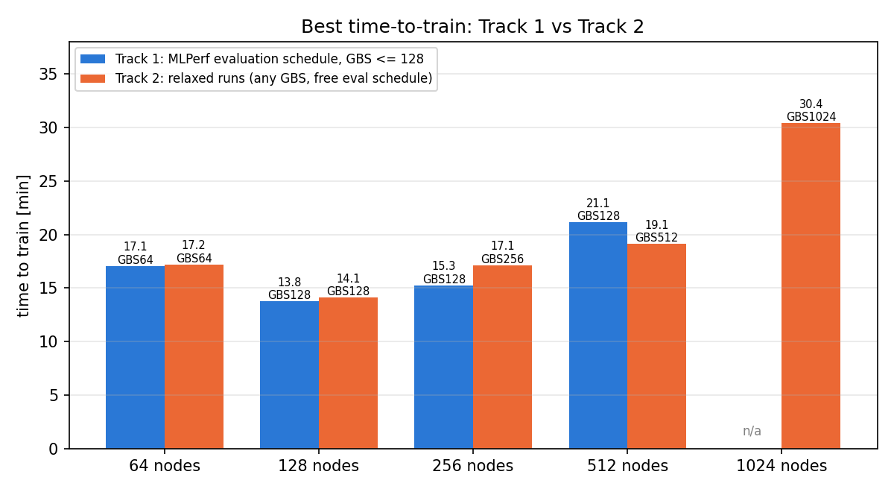

# MLPerf Training Llama 3.1 8B on KISTI Hangang (GH200)

Reproducible recipe for the **MLPerf Training Llama 3.1 8B pretraining** benchmark on KISTI's
6th supercomputer **Hangang** (NVIDIA GH200, HPE Slingshot), using the NVIDIA MLPerf Training
v6.0 implementation, from 1 node (4 GPUs) to 1,024 nodes (4,096 GPUs).

**Best time-to-train: 13.8 min on 128 nodes (512 GH200)** with the MLPerf evaluation schedule.
Every scale from 1 to 1,024 nodes reached the MLPerf quality target (validation log perplexity < 3.3).



Results come in two tracks with the same stop condition: **Track 1** keeps the MLPerf evaluation
schedule (every 12,288 samples) and GBS ≤ 128; **Track 2** allows any global batch and evaluation
schedule. See [docs/RESULTS.md](docs/RESULTS.md).

> Unofficial results: single runs, not reviewed by MLCommons. See [docs/RESULTS.md](docs/RESULTS.md).

Companion repositories:
[mlperf-training-llama2-lora-on-supercomputer](https://github.com/hwang2006/mlperf-training-llama2-lora-on-supercomputer)
(Llama 2 70B LoRA on Hangang) and
[kisti-neuron-mlperf-training](https://github.com/hwang2006/kisti-neuron-mlperf-training)
(reference implementation on NEURON).

More nodes need a larger global batch to keep tensor/context parallelism inside a node, and
above GBS 128 the samples needed to converge grow almost as fast as the batch, so 128 nodes
is the sweet spot ([docs/RESULTS.md](docs/RESULTS.md)).

## The benchmark in one paragraph

Pretrain Llama 3.1 8B (32 layers, GQA, 128K vocab, sequence length 8,192) **from random
weights** on a preprocessed C4 subset (`c4-train.en_6`, ~21B tokens, 84 GB) until the
validation log perplexity on 1,024 C4 validation sequences drops below 3.3. Evaluation runs
every 12,288 sequences and its time counts. Fixed: AdamW (β 0.9/0.95, wd 0.1), clipping 1.0,
cosine decay. Free: global batch (GBS), base LR, warmup, parallelism. We train in FP8 (hybrid
E4M3/E5M2, tensorwise scaling) on a BF16 base, as NVIDIA's Hopper submissions do.

## What you need

| Item | Value |
|---|---|
| Account | Hangang account allowed to submit to a GH200 partition. Site policy decides per group: one test account could use only `5thEx`. All GH200 partitions (`normal`, `natStr`, `5thEx`, `intTest`) have the same nodes |
| `--comment` | A valid `field=...;appl=...` pair (`showappl`); the default `field=efficientai;appl=megatron-lm` is valid |
| Scratch space | ~150 GB: 84 GB C4 data, ~30 GB tokenizer download (weights can be deleted), ~20 GB containers |
| Time | Setup is mostly waiting on downloads, see the table below |

Measured on Hangang with a fresh account (2026-11-06):

| Step | Time |
|---|---|
| Data download (84 GB from MLCommons) | several hours (0.7-8 MB/s from the login node); copying from another user's `/scratch`: 2 min |
| Base image import (NGC, batch job) | 15-60 min |
| aws-ofi-nccl build | 5 min |
| Benchmark container build | 11-70 min |
| 2-node NCCL check | 5 min |
| 4-node smoke test | 6-10 min |

## Quick start

Run everything from a directory under `/scratch` (Hangang only accepts jobs submitted there).
`./scripts/check_setup.sh` prints what is done and the next command at any point:

```
  [ OK ] 0 sources: .../third_party/v60/NVIDIA/benchmarks/llama31_8b/implementations/nemo
  [ OK ] 1 data: /scratch/<user>/mlperf-llama31/data/llama3_1_8b_preprocessed_c4_dataset
  [ .. ] 2 base image: import job running (6.2G downloaded)
  ...
next: wait for the kv6-import job (squeue -u $USER)
```

### 0. Clone and configure

```bash
cd /scratch/$USER
git clone https://github.com/hwang2006/mlperf-training-llama31-8b-on-supercomputer.git
cd mlperf-training-llama31-8b-on-supercomputer
source env.sh
for P in normal natStr 5thEx intTest; do printf "%-8s " $P; sbatch --test-only -p $P -N 1 --gres=gpu:4 -t 10 --comment="$SLURM_COMMENT" --wrap=hostname 2>&1 | tail -1; done
```

Use a partition that answers `Job ... to start at ...` (the others print `allocation failure`)
and put it in `env.local.sh`, your personal settings file (also for `SLURM_COMMENT`,
`DATA_ROOT`, `CONT_DIR`; git ignores it, so `git pull` keeps it):

```bash
echo 'export SLURM_PARTITION=5thEx' >> env.local.sh      # your partition; env.local.sh is not tracked by git
source env.sh && echo "$SLURM_PARTITION | $SLURM_COMMENT | $DATA_ROOT | $CONT_DIR"
```

### 1. Sources and data (login node)

```bash
./scripts/00_fetch_sources.sh | tail -2           # NVIDIA v6.0 implementation, patched callback
setsid nohup ./scripts/04_prepare_data.sh > results/data-download.log 2>&1 < /dev/null &
```

`setsid nohup … &` detaches the job from your terminal; the shell prints `[1]+ Done` at once,
but the download keeps running (`ps -u $USER | grep -E "prepare_data|wget"`). It ends with
`DATA_READY` after checking file sizes. If someone on Hangang already has the data and lets
you read it, copying is much faster:

```bash
S=/scratch/<other user>/mlperf-llama31
mkdir -p "$PREPROC_DATA" "$TOKENIZER"
cp -a $S/data/llama3_1_8b_preprocessed_c4_dataset/. "$PREPROC_DATA/"
cp -a $S/tokenizer/llama3_1_8b_tokenizer_only/. "$TOKENIZER/"
./scripts/04_prepare_data.sh --verify             # DATA_READY
```

### 2. Containers

**2a.** Import the NGC base image (batch job on a GPU node):

```bash
sbatch -p "$SLURM_PARTITION" --comment="$SLURM_COMMENT" scripts/01_import_base_image.sbatch
```

Wait until the job has left `squeue` and its log `results/kv6-import-<job>.log` ends with
`CHECK_EXIT=0` (it also prints `available True` and `cc (9, 0)`). The log stays at
`Downloading 78 missing layers...` for most of the time; `du -sh $ENROOT_CACHE_PATH` shows
progress. If the job times out, submit it again: downloaded layers are reused.

**2b.** Only after 2a has finished, build the Slingshot plugin and the benchmark container:

```bash
./scripts/03_build_ofi_plugin.sh 2>&1 | tee results/ofi-build.log | tail -3     # OFI_BUILD_OK
setsid nohup ./scripts/02_build_container.sh > results/build.log 2>&1 < /dev/null &
```

The build log ends with `BUILD_EXIT=0` and `$CONT_DIR` then holds
`kv6-nv60-llama31-8b-arm64.sqsh` (~10 GB). Both scripts stop at once with
`Base image not found` if 2a is not done yet.

### 3. Network check (2 nodes, ~5 min)

```bash
sbatch -N 2 -p "$SLURM_PARTITION" --comment="$SLURM_COMMENT" slurm/nccl_test.sbatch
grep -E "^##########|world=|allreduce +(512|2048) MB" $(ls -t results/kv6-nccl-*.log | head -1)
```

| Variant | Expected 2 GB all-reduce bus bandwidth |
|---|---|
| C1-C3 (Slingshot CXI) | ~297 GB/s |
| C4 (`OFI_NCCL_PROTOCOL=RDMA`) | ~12 GB/s (falls back to TCP on Hangang) |
| A (TCP reference) | ~10 GB/s |

Full output per variant is in `results/nccl-<job>/`.

### 4. Smoke test (4 nodes, ~6-10 min)

```bash
./submit.sh 4 MAX_STEPS=200 TIME=00:40:00
python3 tools/ttq_status.py results/runs/kv6-l8b-<job>.out
```

Expect a first loss of ~12.58 and about 24 training samples/s. `"status": "aborted"` is normal
for a `MAX_STEPS` run. If one rank fails with `CUDA out of memory` while the others are fine,
a GPU on that node was not empty (seen once on node1802); exclude the node for your runs:
`EXTRA_EXCLUDE=node1802 ./submit.sh 4 MAX_STEPS=200 TIME=00:40:00`.

### 5. Time-to-train runs

```bash
./submit.sh 4                                      # ~140 min
./submit.sh 128 GBS=128 TP=1 CP=4 LR=0.001 WARMUP_STEPS=256 BUCKET_SIZE=2000000000 \
            MAX_STEPS=1200000 TIME=00:40:00 NETPROFILE=cscs      # best: ~14 min
setsid nohup ./scripts/submit_queue.sh recipes/best_per_scale.txt > results/queue.log 2>&1 < /dev/null &
```

[`recipes/README.md`](recipes/README.md) lists the command for every scale, the MLPerf
reference hyperparameters per batch size, and parallelism rules. Hangang allows 5 submitted
jobs per user; `submit_queue.sh` submits a recipe file as slots free up.

## Monitoring

`submit.sh` starts a watchdog for every job. It cancels the job on a NaN loss or if the log
stops for 5 minutes, which is how collective hangs show up on this system.

```bash
squeue -u $USER
python3 tools/ttq_status.py --summary results/runs/kv6-l8b-*.out     # TTT, samples, last eval, throughput
python3 tools/ttq_status.py results/runs/kv6-l8b-<job>.out           # eval curve of one run
python3 tools/collect_runs.py results/runs --sacct                    # all runs -> results/raw/ (commit)
tail -n2 results/watch_<job>.log                                     # watchdog verdict
```

## How a run is launched

```
submit.sh NODES KEY=VALUE…  →  sbatch slurm/run_ttq.sbatch  (+ tools/watch_job.sh)
   ├─ configs/config_GH200_8b.sh    NVIDIA 8B configs minus FP4, GBS/TP/CP/LR from KEY=VALUE
   ├─ srun 1 task/node              unpack the container on every node (abort if any node fails)
   └─ srun 4 tasks/node, hostfile   slurm2pytorch → run_and_time.sh → pretrain.py
          rank 0 pinned to MASTER_ADDR, 16 CPUs per rank, Slingshot via self-built aws-ofi-nccl
```

| `submit.sh` key | Meaning |
|---|---|
| `GBS`, `TP`, `CP`, `MBS` | Global batch and parallelism; `GBS = MINIBS × 4·nodes / (TP·CP)` |
| `LR`, `WARMUP_STEPS` | Base LR and warmup steps (defaults 4e-4 and 20, the Cisco GBS 32 values) |
| `MAX_STEPS`, `VAL_CHECK_INTERVAL` | Short tests; evaluation defaults to every 12,288 samples. `MAX_STEPS` is capped at 4M samples for GBS ≥ 128 |
| `EVAL_START`, `EVAL_EVERY` | Track 2 evaluation schedule in samples (first evaluation, then interval) |
| `BUCKET_SIZE` | Parameters per gradient bucket (default 768,000,000); 2,000,000,000 helps with TP=1 and at DP ≥ 128 |
| `TP_COMM_OVERLAP`, `NUM_DISTOPT_INSTANCES`, `OVERLAP_PG_OPTIM` | Further NVIDIA knobs; none helped on Hangang (docs/RESULTS.md) |
| `NETPROFILE` | CXI environment: `cscs-nordzv` (default), `cscs`, `cscs-rdzv`, `base` |
| `TIME`, `SEED`, `NCCL_DEBUG`, `WATCH=0`, `STALL=<min>` | Slurm time limit, seed, NCCL logging, watchdog control |

## Things that are different on Hangang

Summary of [docs/TROUBLESHOOTING.md](docs/TROUBLESHOOTING.md); the scripts already handle each:

1. The aws-ofi-nccl plugin shipped in NGC 26.04 aborts on Slingshot CXI and NCCL silently uses TCP.
2. Without `--cpus-per-task`, NCCL reaches 40 GB/s instead of ~300 GB/s.
3. Task 0 is not always on the first node of the sorted node list.
4. Collectives can hang silently; the CSCS Slingshot settings fix this up to 64 nodes.
5. Some nodes (most likely node0320-0324) produced NaN loss from the first step; they are excluded in `env.sh`.
6. One node needs TP=2 (96 GB GPUs); builds on login nodes need `OPENBLAS_NUM_THREADS=1`.
7. GBS ≥ 256 timed out during initialisation (dataset index for `MAX_STEPS × GBS` samples); `MAX_STEPS` is now capped.
8. One hang came with CXI `UNDELIVERABLE` send errors from three neighbouring nodes; they are excluded.
9. The best layout changes with scale: CP-heavy up to 128 nodes, TP4 with large gradient buckets from 256 nodes.
10. Each group may submit only to some GH200 partitions; one GPU on node1802 had memory already in use.

## Repository layout

```
env.sh                         paths, Slurm settings, node exclude list
submit.sh                      submit one run (+ watchdog)
configs/config_GH200_8b.sh     GH200 config on top of NVIDIA's 8B configs
slurm/run_ttq.sbatch           time-to-train job
slurm/nccl_test.sbatch         2-node NCCL bandwidth and CXI profile check
scripts/00-04_*                fetch code, import/build containers, build OFI plugin, get data
scripts/check_setup.sh         what is done, what to run next
scripts/submit_queue.sh        submit a recipe file within the 5-job limit
container/                     build steps run inside enroot
recipes/                       validated commands and hyperparameters
tools/                         log parser, status, watchdog, plots, Cisco baseline
results/summary.csv            curated table of the runs in docs/RESULTS.md
results/raw/                   every job: configuration, status, curves, MLPerf log lines (results/README.md)
docs/                          results, troubleshooting, Korean quick guide
```

## Acknowledgements

NVIDIA's MLPerf Training v6.0 implementation and Cisco's v6.0 results are fetched from
[mlcommons/training_results_v6.0](https://github.com/mlcommons/training_results_v6.0) under
their own licenses. Data and tokenizer come from MLCommons via
[r2-downloader](https://github.com/mlcommons/r2-downloader). Slingshot NCCL settings follow the
[CSCS Alps documentation](https://docs.cscs.ch/software/communication/nccl).
Measurements used KISTI Hangang resources.
