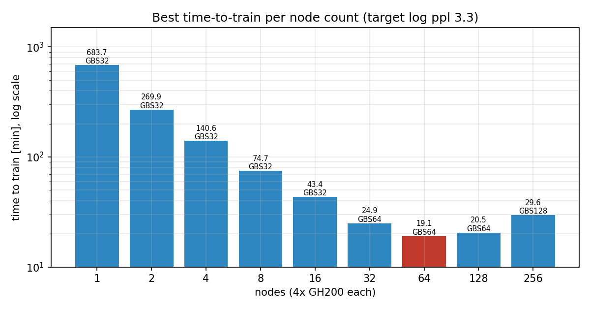
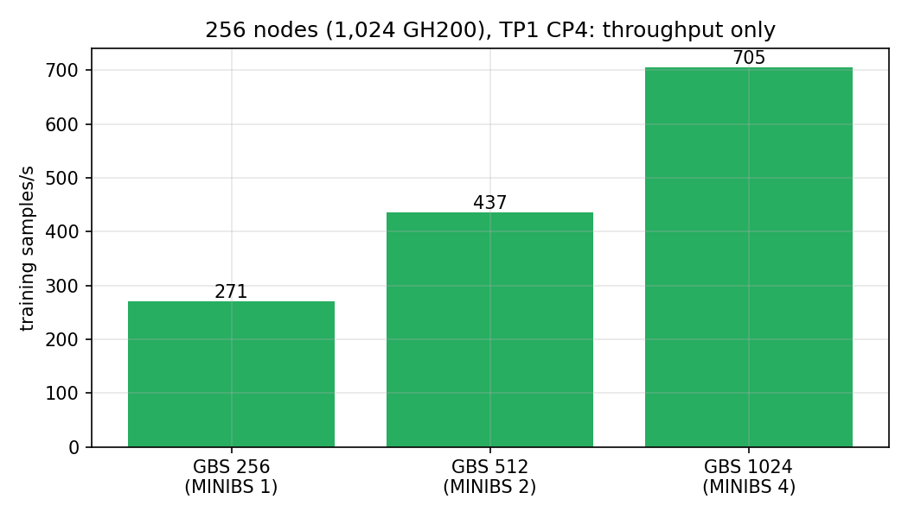

# Results on Hangang (KISTI 6th supercomputer)

All runs reached the MLPerf Training Llama 3.1 8B target (validation log perplexity < 3.3)
with the NVIDIA MLPerf Training v6.0 implementation, FP8 (hybrid, tensorwise) on GH200 96 GB.
Measured 2026-11-01/02. Raw numbers: [`results/summary.csv`](../results/summary.csv);
plots regenerate with `python3 tools/plot_results.py`.

**Best: 19.14 min on 64 nodes (256 GH200), GBS 64, CP4.** Single runs, not MLPerf-reviewed
results; an official score averages 10 runs.

| Nodes | GPUs | GBS | Parallelism | TTT [min] | Samples to target | Train samples/s |
|---:|---:|---:|---|---:|---:|---:|
| 1 | 4 | 32 | TP2 | 683.7 | 208,896 | 5.2 |
| 2 | 8 | 32 | DP8 | 269.9 | 196,608 | 12.4 |
| 4 | 16 | 32 | DP16 | 140.6 | 196,608 | 23.9 |
| 8 | 32 | 32 | DP32 | 74.7 | 196,608 | 45.0 |
| 16 | 64 | 32 | CP2 | 43.4 | 196,608 | 77.2 |
| 32 | 128 | 64 | CP2 | 24.9 | 221,184 | 152.6 |
| 64 | 256 | 64 | CP4 | **19.1** | 221,184 | 206.4 |
| 128 | 512 | 64 | TP2·CP4 | 20.5 | 221,184 | 188.9 |
| 256 | 1,024 | 128 | TP4·CP2 | 29.6 | 344,064 | 199.0 |

## Strong scaling at GBS 32

Throughput is near-linear to 8 nodes (94% of linear), 81% at 16 and 60% at 32 nodes, then
flat. With GBS fixed at 32 the per-step gradient sync does not shrink, and DP is capped at 32,
so extra GPUs only add CP/TP communication.

## A larger global batch above 32 nodes

GBS 64 needs 12-27% more samples to converge but raises throughput by 33-66%, so it wins at
every scale from 32 nodes. 64 nodes is the sweet spot: 128 nodes needs TP2·CP4 and is slower.

GBS 128 converges only with the MLPerf reference hyperparameters (LR 2e-3, 256 warmup steps;
see [`recipes/README.md`](../recipes/README.md)): 64 nodes 22.4 min, 256 nodes 29.6 min.

## 256 nodes: throughput only

300-step runs with all TP/CP traffic inside a node (TP1·CP4). Per-step gradient sync across
256 nodes costs about 0.7 s (about 0.1 s on 64 nodes); more micro-batches per GPU hide it.
GBS 512 and 1,024 have no MLPerf reference hyperparameters, and both runs hung after 64 and
32 steps, so these are not time-to-train results.

## Comparison with MLPerf v6.0 Hopper submissions

| GPUs | Hangang GH200 | Published Hopper result |
|---:|---|---|
| 16 | 140.6 min (4 nodes) | 122.2 min, Cisco 2x8 H200 SXM |
| 64 | 43.4 min (16 nodes, GBS 32) | 33.1 min, Cisco 8x8 H100 (GBS 32) |
| 128 | 24.9 min (32 nodes, GBS 64) | 22.0 min, Cisco 16x8 H100 (GBS 64) |

Cisco evaluated every 8,192 samples; the v6.0 and v6.1 rules (and our runs) use 12,288, which
can add up to one evaluation interval of extra training. Cisco also packs 8 GPUs per node
behind NVSwitch, so 64 GPUs span 8 nodes instead of 16.

## Other measurements

| Measurement | Result |
|---|---|
| TP vs CP inside a node (64 nodes, GBS 64) | CP4 19.14 min, TP4 19.64 min |
| CXI profile `base` vs `cscs` (4 nodes) | 140.6 vs 140.8 min, no throughput cost |
| `base` vs `cscs` (2 nodes) | 269.9 vs 275.3 min (node placement noise) |
| 2-node NCCL all-reduce, 2 GB | 298 GB/s bus bandwidth with CXI, 11.4 GB/s over TCP |
