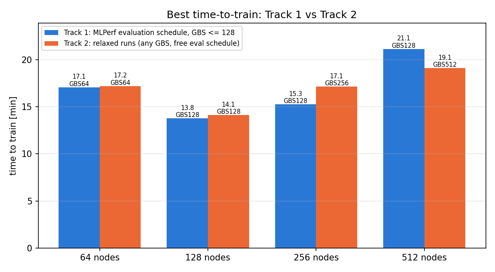
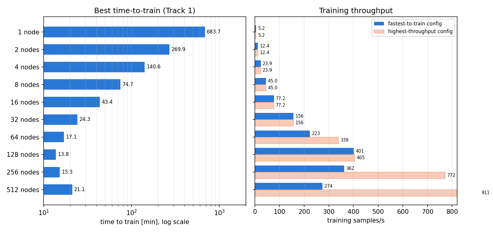
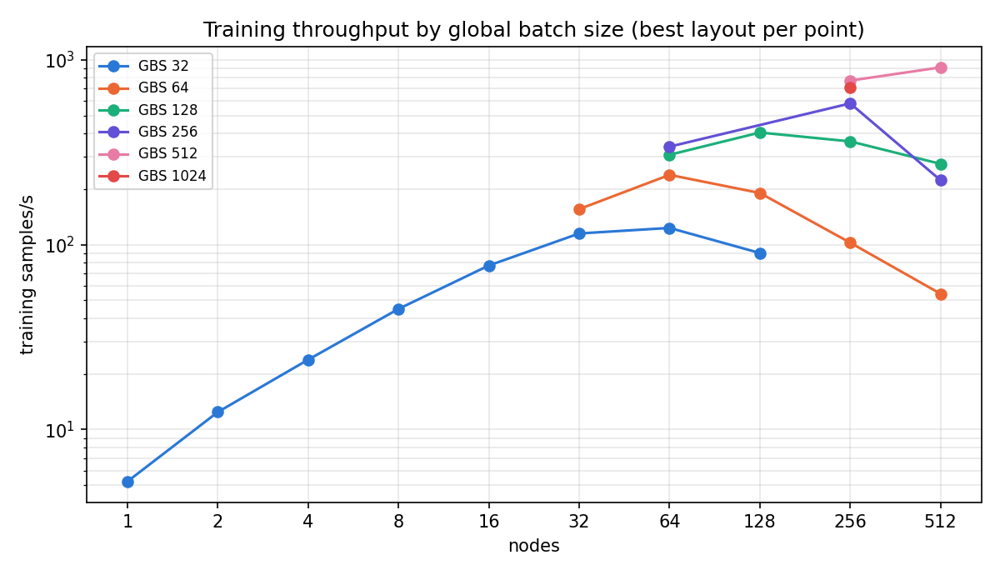
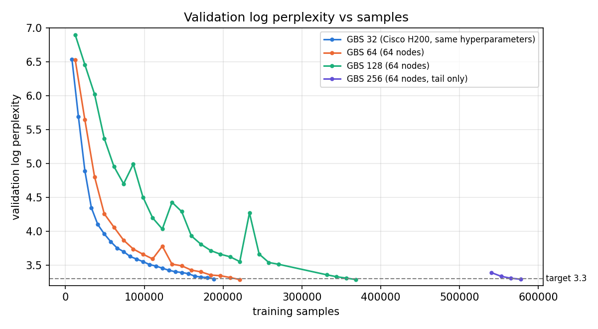
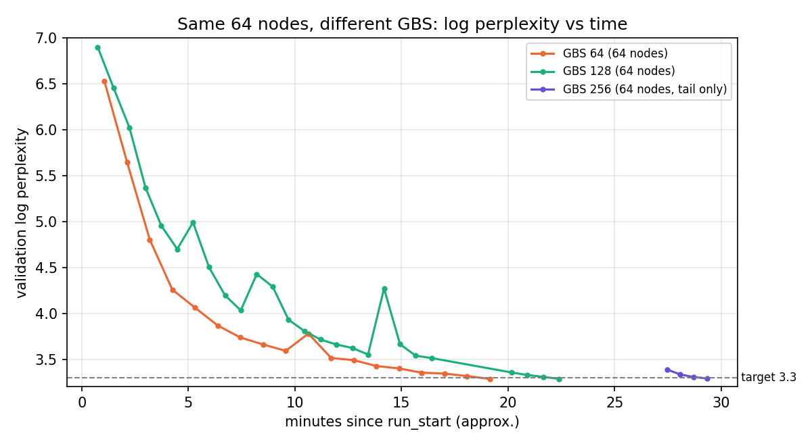
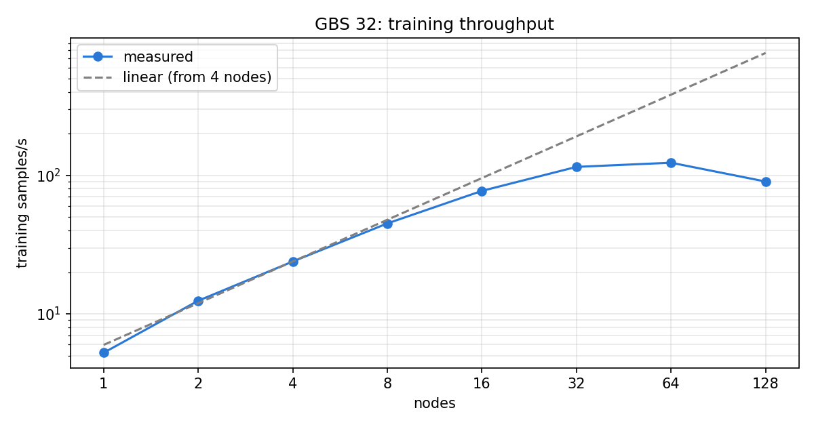
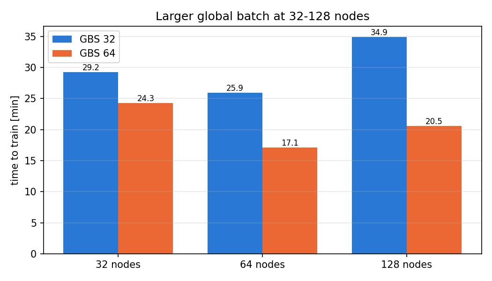

# Results on Hangang (KISTI 6th supercomputer)

MLPerf Training Llama 3.1 8B with the NVIDIA MLPerf Training v6.0 implementation, FP8 (hybrid,
tensorwise) on GH200 96 GB, measured 2026-11-01 to 11-03. All runs are single runs and none is
an MLPerf-reviewed result. Raw data: [`results/summary.csv`](../results/summary.csv) (column
`eval_schedule` tells the tracks apart); plots regenerate with `python3 tools/plot_results.py`.

## Two tracks

| | Track 1: MLPerf evaluation rules | Track 2: relaxed |
|---|---|---|
| Stop condition | validation log perplexity < 3.3 on the same 1,024 C4 sequences | **same** |
| Evaluation | every 12,288 samples, counted in TTT | any schedule (late start, dense near the target) |
| Global batch | ≤ 128 (MLPerf has reference convergence points up to 128) | any |
| LR, warmup, parallelism, buckets, network | free, as in MLPerf | free |
| `eval_schedule` in the CSV | `mlperf` | `relaxed` |

Track 1 is *not* a compliant submission: a submission needs 10 runs, the reference convergence
(RCP) check and MLCommons review. Our GBS 128 runs use LR 1e-3 where the reference uses 2e-3.

## Headline

**Best: 13.77 min on 128 nodes (512 GH200), Track 1.** The first Track 1 run on Hangang took
19.14 min (64 nodes); LR, layout, bucket size and network settings found in Track 2 explain the gain.

| Nodes | GPUs | Track 1 TTT | Configuration | Track 2 TTT | Configuration |
|---:|---:|---:|---|---:|---|
| 1 | 4 | 683.7 | GBS 32, TP2 | | |
| 2 | 8 | 269.9 | GBS 32 | | |
| 4 | 16 | 140.6 | GBS 32 | | |
| 8 | 32 | 74.7 | GBS 32 | | |
| 16 | 64 | 43.4 | GBS 32, CP2 | | |
| 32 | 128 | 24.3 | GBS 64, CP2 | | |
| 64 | 256 | **17.07** | GBS 64, TP2·CP2, LR 1e-3 | 17.20 | GBS 64, TP1·CP4, LR 1e-3 |
| 128 | 512 | **13.77** | GBS 128, TP1·CP4, bucket 2e9, LR 1e-3 | 14.11 | same |
| 256 | 1,024 | **15.27** | GBS 128, TP4·CP2, bucket 2e9, LR 1e-3 | 17.15 | GBS 256, TP4·CP1, bucket 2e9, LR 1e-3 |
| 512 | 2,048 | 21.14 | GBS 128, TP4·CP4, bucket 2e9, LR 1e-3 | **19.11** | GBS 512, TP4·CP1, bucket 2e9, LR 1e-3 |
| 1,024 | 4,096 | — | | (pending) | GBS 1,024, TP4·CP2, bucket 2e9 |

From 64 to 256 nodes Track 1 matched or beat Track 2: the evaluation schedule is worth less
than one minute, and GBS 128 stayed the most sample-efficient batch that still scales. Track 2
only wins at 512 nodes, where GBS 128 forces CP across four nodes while GBS 512 does not.
128 nodes is the sweet spot either way.

## What made it faster

| Change | Where | Effect |
|---|---|---|
| LR 1e-3 for GBS 128 (reference 2e-3) | 64–256 nodes | samples to target 344k–402k → median ~330k (9 runs); fewer loss spikes |
| LR 1e-3 for GBS 256 (vs 2e-3) | 256 nodes | 578k → 516k samples |
| Up to 128 nodes: TP/CP inside a node, CP-heavy | 64–128 nodes | 128 nodes GBS 128: TP1·CP4 405 samples/s, TP4·CP1 318 |
| From 256 nodes: TP4 (4× less gradient to synchronise across nodes) | 256–512 nodes | 256 nodes GBS 128: TP1·CP8 238 → TP4·CP2 362; 512 nodes GBS 512: TP1·CP4 601 → TP4·CP1 911 |
| `BUCKET_SIZE=2000000000` with TP = 1, or with any TP at DP ≥ 128 | 64–512 nodes | +8–12% at 64 nodes (TP1); +85% at 512 nodes (TP4·CP1, DP 512: 911 vs 493 samples/s) |
| TP2·CP2 instead of TP1·CP4 for GBS 64 | 64 nodes | +10–16% |
| `NETPROFILE=cscs`, excluded nodes | ≥ 64 nodes | no hangs or NaN in any of today's 34 jobs except one CXI error event |

`BUCKET_SIZE` counts parameters per gradient bucket (BF16, so 768M ≈ 1.5 GB). Each GPU holds
8.0B/TP parameters, so 2e9 means ~4 buckets with TP1 but only 2 with TP2, which leaves too
little to overlap with the backward pass:

| 64 nodes | 768M | 1.0B | 1.5B | 2.0B |
|---|---:|---:|---:|---:|
| GBS 64, TP2·CP2 | **225–239** | 199 | 205 | 212–213 |
| GBS 64, TP1·CP4 | 206 | | | **229** |
| GBS 128, TP1·CP2 | 283 | | | **299–307** |

At DP 512 the picture flips: with TP4 each GPU holds 2.0B parameters, so 2e9 is a single
bucket with no overlap at all, yet it beats three 768M buckets by 85% (512 nodes, GBS 512,
TP4·CP1: 911 vs 493 samples/s). Each collective across 512 nodes carries a large fixed
latency, so fewer, larger collectives win; overlap matters only while that latency is small.

Options that did not help at 64 nodes (100-step probes):

| Option | Result |
|---|---|
| `NUM_DISTOPT_INSTANCES=2` | −25 to −31% |
| `FP8_ATTN=1` | fails: `No dot product attention backend is available` with CP |
| `OVERLAP_PG_OPTIM=True` | fails at init: `IndexError` |
| GBS 128 TP2·CP1 (bucket 1e9) | 279, vs 300 for TP1·CP2 with bucket 2e9 |

## Throughput vs convergence

More nodes need a larger GBS (DP cannot exceed GBS), and above GBS 128 the samples needed to
reach the target grow almost as fast as the batch:

| GBS | Samples to target (LR 1e-3 unless noted) | vs previous GBS | MLPerf reference mean |
|---:|---|---:|---:|
| 32 | 184k–209k (LR 4e-4) | | 179k |
| 64 | 209k–258k | | 227k |
| 128 | 307k–393k, median ~330k | ~1.45× | 346k (LR 2e-3) |
| 256 | 516k–522k (LR 2e-3: 578k) | ~1.6× | none |
| 512 | 0.93M–1.15M (4 runs) | ~1.9× | none |

At 512 nodes with TP1·CP4, GBS 512 leaves one micro-batch per GPU: ~0.2 s of compute against
~0.7 s of gradient synchronisation across 2,048 GPUs (601 samples/s). TP4·CP1 shrinks the
gradient each GPU synchronises to a quarter and reaches 911 samples/s (0.58 s per step).

Same 64 nodes, different GBS (LR 2e-3 runs from 2026-11-02; time axis approximate):

## Run-to-run variance

Samples-to-target varies ±10–20% between runs with identical settings, and throughput varies
5–10% with node placement. Examples: 64 nodes, GBS 64, TP2·CP2, LR 1e-3, Track 1: 19.60 min
(258k samples) and 17.07 min (221k); 128 nodes, GBS 128: 13.77 and 14.32 min; 256 nodes, GBS 128:
28.35 min at 393k samples where ~330k was typical. Compare configurations on repeated runs.

## Strong scaling at GBS 32 (2026-11-01/02)

Near-linear to 8 nodes (94%), 81% at 16 and 60% at 32 nodes, then flat: with GBS fixed, DP is
capped at 32 and extra GPUs only add CP/TP communication.

## Comparison with MLPerf v6.0 Hopper submissions

| GPUs | Hangang GH200 (Track 1) | Published Hopper result |
|---:|---|---|
| 16 | 140.6 min (4 nodes, GBS 32) | 122.2 min, Cisco 2x8 H200 SXM |
| 64 | 43.4 min (16 nodes, GBS 32) | 33.1 min, Cisco 8x8 H100 (GBS 32) |
| 128 | 24.3 min (32 nodes, GBS 64) | 22.0 min, Cisco 16x8 H100 (GBS 64) |
| 512 | 13.77 min (128 nodes, GBS 128) | none |

Cisco evaluated every 8,192 samples (the v6.0/v6.1 rules say 12,288) and packs 8 GPUs per node
behind NVSwitch. The 16–128 GPU Hangang rows predate the LR 1e-3 and bucket findings.

## Other measurements

| Measurement | Result |
|---|---|
| TP vs CP inside a node (64 nodes, GBS 64, 768M buckets) | TP1·CP4 206, TP2·CP2 225–239, TP4·CP1 193 samples/s |
| CXI profile `base` vs `cscs` (4 nodes) | 140.6 vs 140.8 min |
| 2-node NCCL all-reduce, 2 GB | 298 GB/s bus bandwidth with CXI, 11.4 GB/s over TCP |
| 256 nodes, TP1·CP4, 768M buckets, 300 steps | GBS 256/512/1,024: 271/437/705 samples/s |
